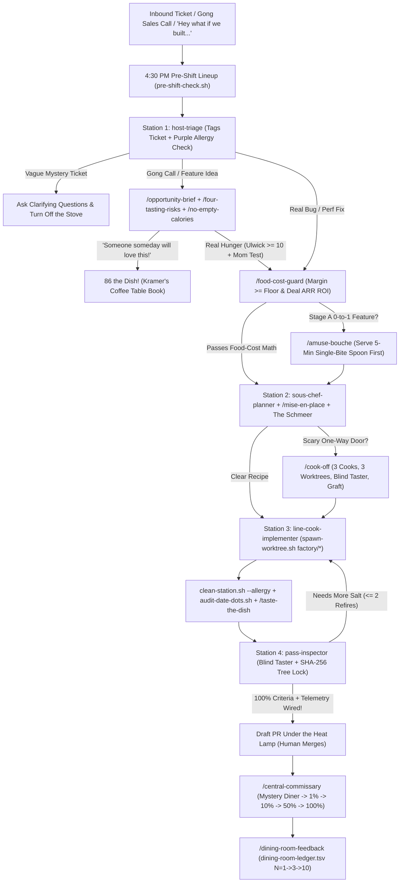

# Welcome to the Kitchen (`principled-product-factory`)

Grab an apron. Wash your hands. Leave your "let's slap an AI chatbot on the sidebar and see what happens" ideas by the dumpster out back.

**`principled-product-factory`** is a **42-skill modular cookbook**, **5-station subagent brigade** (`Brigade de Cuisine`), and **9-script mechanical assembly line** for **Claude Code**, **Cursor**, and **Antigravity**.

We built this because AI coding agents have made writing code 10x faster—which mostly means teams can now cook **inedible dishes nobody ordered at 10x the speed**, burn through GPU token budgets like Kramer and Newman driving a mail truck full of 10-cent soda cans to Michigan, and call it "velocity."

Instead of one giant 3,000-line prompt that your agent forgets by turn four, this repo runs your product, engineering, and sales workflow like an obsessive, Michelin-starred kitchen:

1. **Marty Cagan's Product Trio & No Empty Calories (`/opportunity-brief`, `/four-tasting-risks`, `/no-empty-calories`)**: We don't run a mercenary Feature Factory that blindly cooks whatever feature list somebody scribbled on a napkin. We unbundle every request into the underlying **Diner Problem + Outcome Metric**, test **Value, Usability, Feasibility (Day-0 Sous Chef spike), and Business Viability Risks** upfront, and if a dish is backed only by *"I think users at some point will really like it!"*, we **86 it at the door**.
2. **Billy Crystal's "The Schmeer" (`/opportunity-brief`, `/plating-and-experience`)**: Giving customers literally what they asked for is just the bagel. **The Schmeer** is when you nail the bagel first—and then look **30 seconds past where the customer stopped talking** to solve their immediate next copy-paste, terminal command, or anxiety in $\le 15\%$ extra code (warm-madeleine economics: 40 cents of butter and flour, $10\times$ the hospitality).
3. **Food-Cost Math Before Firing (`/food-cost-guard`)**: Every dish has to pay for its own ingredients (tokens, third-party APIs, infrastructure, and human review time). If a dish loses money on every plate served, it doesn't go on the menu.
4. **A Four-Station Kitchen Brigade (`/kitchen-brigade` + `agents/*.md`)**: The Expediter calls the tickets at the pass and never touches a frying pan. Every ticket moves through four isolated stations—**`host-triage` $\to$ (`forager-researcher`) $\to$ `sous-chef-planner` $\to$ `line-cook-implementer` $\to$ `pass-inspector`**—ending in a plated **Draft Pull Request** sitting under the heat lamp for you (the Head Chef) to ring the bell and merge.
5. **Blind Taste Tests, Purple Allergy Kits & Clean Cutting Boards (`/allergy-alert`, `/fifo-walk-in`, `/cook-off`, `/taste-the-dish`)**: Line cooks don't grade their own sauces. Our Pass Inspector never hears the Line Cook's excuses, verifies the working tree SHA-256 wasn't mutated, enforces **Purple-Board Allergy Protocols** on Auth/Billing/PII/Multi-Tenant tickets, checks green painter's tape **`FIFO-DATE-DOT`** expiration stickers, and literally has its `Edit` and `Write` tools confiscated at the door.
6. **Gong Call Harvesting & A Master Sommelier at the Deal Desk (`/dining-room-feedback`, `/sommelier-table-pitch`)**: Drop a raw **Gong sales call transcript** on the pass: the kitchen scrubs PII/emails/phone numbers, cross-checks what the buyer *said* against what your codebase actually *does*, logs the pain to a persistent cross-session ledger (`dining-room-ledger.tsv`) tracking $N=1 \to 3 \to 10$ accounts and total ARR at stake, proposes **The Schmeer**, and hands you a Challenger Sale + JOLT follow-up playbook that closes the deal without caving on price.

---

## 1. Set Up Your Station in 30 Seconds

### Option A: Inside Claude Code (Two Commands, Zero Chopping)
Open Claude Code and drop these two lines in the chat:
```text
/plugin marketplace add agronomist/principled-product-factory
/plugin install kitchen-brigade@principled-product-factory
```

### Option B: The One-Line Shell Installer (`install.sh`)
Prefer symlinks you can see with your own eyes? Clone the repo and run `./install.sh`:
```bash
git clone https://github.com/agronomist/principled-product-factory.git
cd principled-product-factory

# Install globally for every repo on your machine (~/.claude & ~/.cursor)
./install.sh

# Or install into one specific project (installs skills, agents, and PreToolUse safety hooks)
./install.sh /path/to/your/project
```

### Wait—Do I Have to Memorize 42 Skills? (No. You Only Need 5 Commands.)
You never order à la carte off a 42-item prep binder. You use **5 front-of-house commands**, and `/head-chef-mode` automatically pulls the right service playbook and back-of-house skills off the rack:

| Front-of-House Command | When to Type It |
| :--- | :--- |
| **[`/head-chef-mode`](skills/head-chef-mode/SKILL.md)** | **Your main command.** Hand it a bug, a feature idea, a slow query, or a Gong sales transcript—it picks the playbook and runs the brigade. |
| **[`/setup-kitchen`](skills/setup-kitchen/SKILL.md)** | **First day on the line.** Configures your station models (**Bistro Fast**, **Michelin Standard**, or **Tasting Menu Maximum**) in 60 seconds. |
| **[`/kitchen-help`](skills/kitchen-help/SKILL.md)** | **Lost in the walk-in cooler?** Tell it what you're trying to do and it hands you the exact copy-paste prompt. |
| **[`/cook-off`](skills/cook-off/SKILL.md)** | **Big architectural decision.** Spawns 3 contenders on 3 isolated `git worktree` cutting boards, blind-tastes them, and grafts the winning parts. |
| **[`/shift-handoff`](skills/shift-handoff/SKILL.md)** | **Morning espresso catch-up.** Summarizes `decisions.tsv`, what passed tasting, what got dumped, and every Draft PR waiting for your merge. |

---

## 2. How an Order Moves From the Door to the Pass

Here is what happens when a ticket or Gong call walks into our kitchen (spoiler: most bad ideas don't survive past the Host stand):



---

## 3. Copy-Paste Orders for Your Next Shift

Here are eight fan favorites you can paste right into Claude Code:

### 1. Drop a Gong Sales Call Transcript on the Pass (`dining-room-harvest`)
> *"I just got off a 45-minute Gong call with a \$60k prospect. Scrub their PII, check if what they complained about is real in our code, log it to our cross-call ledger, tell me what 'The Schmeer' is, and write my deal follow-up."*
```text
/head-chef-mode Process this Gong sales call transcript (@gong-call.txt, $60k ARR). Run the dining-room-harvest playbook: scrub PII into an anonymized account tag, check Say-vs-Do against our codebase, log each validated pain point to dining-room-ledger.tsv via log-guest-feedback.sh (with N=1->3->10 and ARR rollup), propose 3 options plus Billy Crystal's "The Schmeer" (<=15% effort next-step delighter), and give me the /sommelier-table-pitch follow-up packet to close the deal.
```

### 2. Turn an Issue into a Blind-Inspected Draft PR (`ticket-to-pass`)
> *"Look, a bug walked in. Check the walk-in, run it through the 4 stations on a clean cutting board, wipe the station down, taste it, and leave a Draft PR under the heat lamp."*
```text
/head-chef-mode Run the ticket-to-pass playbook on issue #202 ("Duplicate webhook notifications on retry"). Run pre-shift-check.sh first, route through host-triage, sous-chef-planner, line-cook-implementer (on an isolated git worktree branch factory/issue-202), and pass-inspector. Stop at a Draft PR, bus the worktree, and log every station to decisions.tsv.
```

### 3. The "Is This an Urban Sombrero?" Feature Triage (`test-kitchen-tasting`)
> *"Someone wants to spend 3 weeks building a 3D animated dashboard. Let's check if customers actually care or if we're falling into the Build Trap."*
```text
/head-chef-mode Run the test-kitchen-tasting playbook on this proposal: "<describe feature>". Unbundle it with /opportunity-brief (including 3 options and The Schmeer), score Marty Cagan's 4 Big Risks with /four-tasting-risks and /no-empty-calories, and check /food-cost-guard. Tell me plainly if we should cook it, serve a 5-minute /amuse-bouche, or 86 it.
```

### 4. The 3-Chef Cook-Off (`/cook-off`)
> *"We only get one shot at this architecture decision. Put three cooks on three separate cutting boards, blind-taste all three, and combine the best parts."*
```text
/cook-off We need to design the state persistence and retry boundary for <module>. Spawn 3 contenders on isolated git worktrees, judge them blind against a 4-criterion rubric (Liskov contracts, food-cost efficiency, failure recovery, smallest API surface), pick the cleanest base, and graft the best edge-case guards from the runners-up.
```

### 5. Reduce the Sauce Until It Shines (`recipe-reduction-loop`)
> *"This endpoint is slow. Try one small tweak at a time, check the meat thermometer, keep what works, and dump the pan immediately if it regresses."*
```text
/head-chef-mode Run the recipe-reduction-loop playbook to improve <metric> from <baseline> to <target>. Capture the baseline with /taste-the-dish and /thermometer-check first, run one atomic hypothesis bracket at a time (commit if VERIFIED, hard-revert if regressed or INCONCLUSIVE), enforce /principle-check-the-oven after 2 failed tweaks, and log every bracket to decisions.tsv.
```

### 6. Call the Sommelier to the VIP Table (`/sommelier-table-pitch`)
> *"A big enterprise prospect wants a 25% discount AND a weird custom XML button. Help me push back with class and close the deal."*
```text
/sommelier-table-pitch Prepare an enterprise deal desk playbook for <Prospect Name> ($60k ACV). Write the 6-step Commercial Teaching choreography quantifying their annual Cost of Inaction (>= 3x ACV), tailor briefs for the CFO, VP Eng, Champion, and Operator, write a Constructive Tension pushback script for their custom feature/discount request, and include a JOLT playbook to close within 14 days.
```

### 7. Surprise Health Inspection (`/health-inspector` + `/cross-contamination`)
> *"Tear this branch apart. No opinions about variable names—only complaints you can prove by breaking the code with a real command."*
```text
/health-inspector Stress-test the current branch diff against main. Only report violations you prove with a real failing command or repro script. Then run /cross-contamination to identify the single safety fact downstream callers depend on and prove it by running real code.
```

### 8. Morning Coffee Shift Handoff (`/shift-handoff`)
> *"I went to sleep while the kitchen ran overnight. What happened, what got dumped in the sink, and what's waiting at the pass for my signature?"*
```text
/shift-handoff Catch me up on everything that changed in the kitchen since my last message. Read decisions.tsv and active factory/* branches, summarize what passed tasting and what was dumped, and list every Draft PR waiting at the pass with everything I need to decide right here.
```

---

## 4. Meet the Brigade (All 5 Subagents & 42 Skills)

### The 5 Native Claude Code Station Subagents (`agents/` $\to$ `.claude/agents/`)
Each station runs in a fresh, stateless shift and only gets the exact kitchen tools it needs:

| Station Subagent | Who They Are & What Tools They Hold |
| :--- | :--- |
| **[`host-triage`](agents/host-triage.md)** | **The Host at the Door (Classifier)**: Read-only (`Read, Grep, Glob`). Checks the reservation, tags the ticket, flags `purple_board_allergy` & `amuse_bouche_candidate`, or stops the line with `needs_clarification`. |
| **[`forager-researcher`](agents/forager-researcher.md)** | **The Forager (Researcher)**: Read + Web (`Read, Grep, Glob, WebSearch, WebFetch`). Heads out to the farmers' market when you need an upstream bug report or library changelog, and saves a pass-by-ID prep note. |
| **[`sous-chef-planner`](agents/sous-chef-planner.md)** | **The Sous Chef (Product Trio Tech Lead)**: Read-only (`Read, Grep, Glob`). Runs the Day-0 Feasibility Spike (`/four-tasting-risks`), unbundles problems + proposes **Billy Crystal's "The Schmeer"** (`/opportunity-brief`), sets up `/mise-en-place`, and writes **verbatim plating criteria** (including `/plating-and-experience` & `Plated != Eaten` telemetry). |
| **[`line-cook-implementer`](agents/line-cook-implementer.md)** | **The Line Cook (Implementer)**: Full station tools (`Read, Edit, Write, Grep, Glob, Bash`). Cooks on an isolated `factory/<ticket-id>` branch, tastes the dish, wipes the board, and plates the commit. |
| **[`pass-inspector`](agents/pass-inspector.md)** | **The Blind Pass Inspector (Reviewer)**: Read + test runner (`Read, Grep, Glob, Bash` — **`Edit` and `Write` are confiscated at the door**). Runs `clean-station.sh` & `audit-date-dots.sh`, verifies the working-tree SHA-256 lock, enforces `/allergy-alert` negative tests and `Plated != Eaten` telemetry, and grades verbatim criteria blind. |

---

### Master Mode & Onboarding (3 Skills)
| Skill | What It Does on the Line |
| :--- | :--- |
| **[`/head-chef-mode`](skills/head-chef-mode/SKILL.md)** | The Expediter at the pass. Matches your request to one of 7 service playbooks ([`ticket-to-pass`](skills/head-chef-mode/playbooks/ticket-to-pass.md), [`test-kitchen-tasting`](skills/head-chef-mode/playbooks/test-kitchen-tasting.md), [`recipe-reduction-loop`](skills/head-chef-mode/playbooks/recipe-reduction-loop.md), [`sommelier-table-pitch`](skills/head-chef-mode/playbooks/sommelier-table-pitch.md), [`first-tables-and-service-speed`](skills/head-chef-mode/playbooks/first-tables-and-service-speed.md), [`dining-room-harvest`](skills/head-chef-mode/playbooks/dining-room-harvest.md), [`off-menu-special`](skills/head-chef-mode/playbooks/off-menu-special.md)) and hands [`station-brief.md`](skills/head-chef-mode/station-brief.md) to every cook. |
| **[`/setup-kitchen`](skills/setup-kitchen/SKILL.md)** | Interactive 1-minute setup for station models, token budgets, and live tasting harnesses. |
| **[`/kitchen-help`](skills/kitchen-help/SKILL.md)** | Friendly maitre d' that routes you to the right skill, troubleshoots weird shifts, and hands you [`references/recipe-prompts.md`](skills/kitchen-help/references/recipe-prompts.md). |

### Daily Chef Rituals: Lineup, Allergy Kit, Date Dots, *Stage* & Amuse-Bouche (5 Skills)
| Skill | What It Does on the Line |
| :--- | :--- |
| **[`/pre-shift-lineup`](skills/pre-shift-lineup/SKILL.md)** | The 4:30 PM pre-shift walk-in check ([`pre-shift-check.sh`](skills/head-chef-mode/scripts/pre-shift-check.sh)): verifies the base stockpot (`main`) isn't already sour, checks active `factory/*` cutting boards (`WIP <= 5`), scans FIFO date dots, and inspects station cleanliness before service starts. |
| **[`/allergy-alert`](skills/allergy-alert/SKILL.md)** | The **Purple Allergy Kit** for high-blast-radius tickets touching Auth, Multi-Tenant SQL Isolation, Billing, Secrets/Crypto, PII, or Destructive Migrations. Forces negative exploit criteria, `/health-inspector` proof, and [`clean-station.sh --allergy`](skills/head-chef-mode/scripts/clean-station.sh). |
| **[`/fifo-walk-in`](skills/fifo-walk-in/SKILL.md)** | Green painter's tape & Sharpie Date Dots (`FIFO-DATE-DOT: expires=YYYY-MM-DD ticket=<id> action=86-or-graduate`) for temporary feature flags and shims, backed by [`audit-date-dots.sh`](skills/head-chef-mode/scripts/audit-date-dots.sh). |
| **[`/stage-tryout`](skills/stage-tryout/SKILL.md)** | The one-shift ***Stage* (trail audition)**: test a new LLM model, library, or skill rewrite by replaying one solved historical ticket in an isolated worktree and scoring it head-to-head against your incumbent baseline before hiring it onto the main line. |
| **[`/amuse-bouche`](skills/amuse-bouche/SKILL.md)** | **Serve the spoon before boiling the 40-gallon stockpot**: for Stage A 0-to-1 features, plate a working 5-minute single-bite interactive/CLI slice with fixture data so you can taste the workflow before spending 20,000 tokens on database migrations. |

### Marty Cagan Product Trio, Billy Crystal's "The Schmeer", Menu Value, Food Cost & Sommelier (11 Skills)
| Skill | What It Does on the Line |
| :--- | :--- |
| **[`/opportunity-brief`](skills/opportunity-brief/SKILL.md)** | **Missionaries + Billy Crystal's "The Schmeer"**: strips off prescribed feature requests (*"Build button X"*), answers Marty Cagan's 4 Opportunity Questions, pitches **3 competing dish concepts**, and adds **The Schmeer** (the unspoken next step 30 seconds after the feature finishes at $\le 15\%$ effort). |
| **[`/four-tasting-risks`](skills/four-tasting-risks/SKILL.md)** | **Cagan's 4 Big Risks Scorecard & High-Integrity Reservations**: de-risks **Value, Usability, Feasibility (Day-0 Sous Chef spike), and Business Viability** before firing line cooks, and forbids promising hard delivery dates until Discovery retires all 4 risks. |
| **[`/plating-and-experience`](skills/plating-and-experience/SKILL.md)** | **The Product Trio's Design & UX Seat**: enforces Time-to-First-Bite ($\le 3$ steps), Empty-Plate first-run guidance, Burned-Plate fix-naming errors (`ERROR: ... FIX: ...`), zero kitchen plumbing on the guest table, **The Schmeer**, and **`Plated != Eaten` mandatory outcome telemetry hooks**. |
| **[`/no-empty-calories`](skills/no-empty-calories/SKILL.md)** | Our Anti-Build-Trap bouncer. Requires Ulwick JTBD Opportunity Score $\ge 10.0$, *The Mom Test* skin-in-the-game, and 86's untouched zombie features after 30 days. |
| **[`/food-cost-guard`](skills/food-cost-guard/SKILL.md)** | Enforces `unit_revenue - (inference_cost + data_api_cost + hitl_prob * human_review_cost + infra_cost) >= min_margin`, blocks molecular-gastronomy AI foam where SQL suffices, and runs 6-month menu re-pricing audits. |
| **[`/kitchen-brigade`](skills/kitchen-brigade/SKILL.md)** | Runs the 4 stations in order, passes long memos by validated ticket ID (`^[a-z0-9]+(?:-[a-z0-9]+)*$`), guards the Master Recipe Book against prompt poisoning, and stops at a Draft PR. |
| **[`/sommelier-table-pitch`](skills/sommelier-table-pitch/SKILL.md)** | Challenger Sale 6-step commercial teaching choreography ($\text{COI} \ge 3\times \text{ACV}$), pairing value to every seat at the table, Give-Get check control, and JOLT menu-paralysis de-risking. |
| **[`/signature-dish-moat`](skills/signature-dish-moat/SKILL.md)** | April Dunford's 5-step menu positioning canvas, Hamilton Helmer's 7 Powers moat check, and Porter defense against greedy truffle purveyors. |
| **[`/dining-room-feedback`](skills/dining-room-feedback/SKILL.md)** | Harvests **Gong sales call transcripts** & plate-backs (`user_correction_diff`), scrubs PII via [`log-guest-feedback.sh`](skills/head-chef-mode/scripts/log-guest-feedback.sh), tracks cross-session $N=1 \to 3 \to 10$ accounts & total ARR at stake in `dining-room-ledger.tsv`, and updates Bayesian hunger beliefs. |
| **[`/central-commissary`](skills/central-commissary/SKILL.md)** | Stamps out new `products/<slug>/` kitchen lines, harvests Rule-of-Two mother sauces into `platform/`, simulates $3\times$ supplier price shocks, runs mystery-diner holdouts, serves `1%->100%` first tables, and finds Goldratt OEE bottlenecks. |
| **[`/pantry-backup-and-incident-card`](skills/pantry-backup-and-incident-card/SKILL.md)** | 3-tier pantry fallback chain (`primary -> secondary -> tertiary`), SHA-256 duplicate burn-signature Saga pan-dumping, and laminated JSON incident cards for $\pm 3\sigma$ excursions. |

### Mise en Place, Cook-Off, Tasting, Inspection & Shift Handoff (13 Skills)
| Skill | What It Does on the Line |
| :--- | :--- |
| **[`/mise-en-place`](skills/mise-en-place/SKILL.md)** | Measures and labels every container (types, function signatures, Liskov pre/postconditions) before anyone lights a stove. |
| **[`/cook-off`](skills/cook-off/SKILL.md)** | Puts $N$ line cooks on isolated `git worktree` cutting boards with the same brief, blind-tastes them with a cross-vendor judge, picks the simplest base, and grafts the winning garnishes. |
| **[`/health-inspector`](skills/health-inspector/SKILL.md)** | Adversarial inspection where complaints only survive if the inspector proves them with a real failing command. |
| **[`/cross-contamination`](skills/cross-contamination/SKILL.md)** | Checks if your garlic prep just ruined the pastry station three hops downstream, and proves the one safety fact by running real code. |
| **[`/taste-the-dish`](skills/taste-the-dish/SKILL.md)** | Builds and maintains a live app tasting harness (`Fire Up -> Station Check -> Plate -> Proof -> Dishpit`) and living diner-POV menu map ([`features/`](features/README.md)). |
| **[`/verify-kitchen-cookbook`](skills/verify-kitchen-cookbook/SKILL.md)** | This repository's own live tasting harness! Drives every feature in [`features/README.md`](features/README.md), tests negative mutations and clean external installs, and writes `.audit/evidence/proof-kitchen-cookbook.json`. |
| **[`/thermometer-check`](skills/thermometer-check/SKILL.md)** | Sticks a meat thermometer into any benchmark or eval number across 7 checks (did cooking happen, physical limiter, zero spoilage, repeatability, parity, CUPED/SRM, relevance). |
| **[`/haccp-statechart`](skills/haccp-statechart/SKILL.md)** | Formally verifies critical concurrency (`WIP_LIMIT = 5`), retry, Saga, and circuit-breaker state machines, proves checks fail on spoiled mutations, and draws Mermaid statecharts. |
| **[`/prep-log`](skills/prep-log/SKILL.md)** | Appends sanitized single-line TSV rows to `decisions.tsv` ([`scripts/log-decision.sh`](skills/head-chef-mode/scripts/log-decision.sh)) and audits evidence pointers with a cross-vendor taster. |
| **[`/sharpen-the-knives`](skills/sharpen-the-knives/SKILL.md)** | Fixes recurring kitchen accidents up the 5-level hierarchy: **1. Kitchen Layout $\to$ 2. Labeled Containers $\to$ 3. Fix-Naming Alarm $\to$ 4. Taste Test $\to$ 5. Wall Sign last**. |
| **[`/shift-handoff`](skills/shift-handoff/SKILL.md)** | Morning catch-up over espresso: what shipped, what got dumped, and every Draft PR waiting under the heat lamp with everything you need to decide right now. |
| **[`/update-the-cookbook`](skills/update-the-cookbook/SKILL.md)** | Mines the shift transcript for durable 6-month lessons and proposes surgical upgrades to `skills/*/SKILL.md`. |
| **[`/plain-english-menu`](skills/plain-english-menu/SKILL.md)** | Scrapes off AI buzzword foam, labels evidence (`measured`, `inferred`, `guess`), and supplies our **Soccer, Seinfeld & Billy Crystal Metaphor Bank**. |

### The 10 Non-Negotiable Kitchen Principles (`principle-*`)
- [`principle-no-empty-calories`](skills/principle-no-empty-calories/SKILL.md) — *Don't cook Kramer's Coffee Table Book.*
- [`principle-food-cost-floor`](skills/principle-food-cost-floor/SKILL.md) — *Don't run the Michigan bottle-deposit mail truck.*
- [`principle-expediter-calls-not-cooks`](skills/principle-expediter-calls-not-cooks/SKILL.md) — *The Expediter calls the tickets, never works the fryer.*
- [`principle-blind-taste-test`](skills/principle-blind-taste-test/SKILL.md) — *Cooks never grade their own sauce.*
- [`principle-plate-at-the-pass`](skills/principle-plate-at-the-pass/SKILL.md) — *Unattended shifts stop at a Draft PR under the heat lamp.*
- [`principle-clean-cutting-boards`](skills/principle-clean-cutting-boards/SKILL.md) — *Separate worktrees + The Soup Nazi's 5-ticket limit (`WIP_LIMIT = 5`).*
- [`principle-check-the-oven`](skills/principle-check-the-oven/SKILL.md) — *If two tweaks fail the same check, check if the oven is lit; if George hits the hydrant twice, stop parallel parking.*
- [`principle-taste-before-serving`](skills/principle-taste-before-serving/SKILL.md) — *"The recipe compiled" is not a taste test.*
- [`principle-one-course-at-a-time`](skills/principle-one-course-at-a-time/SKILL.md) — *Cook riskiest-ingredient-first; keep or dump one pan at a time.*
- [`principle-kitchen-muscle-memory`](skills/principle-kitchen-muscle-memory/SKILL.md) — *Nobody reads laminated wall signs during a Saturday-night rush—encode lessons in layout, containers, and alarms.*

---

## 5. Built-In Bouncer & Portable Kitchen Levers

Instead of trusting an LLM to pinky-promise it read the rules, we ship 9 executable shell levers in [`skills/head-chef-mode/scripts/`](skills/head-chef-mode/scripts/) and a Claude Code plugin hook in [`hooks/hooks.json`](hooks/hooks.json) + [`hooks/pre-tool-guard.sh`](hooks/pre-tool-guard.sh) (also installed automatically by `./install.sh` into `.claude/hooks/`). Pair this local bouncer with **GitHub Branch Protection** on `main` as your server-side lock:

```bash
# Works in this repo OR in any project where you ran `./install.sh /path/to/project`:

# 1. 4:30 PM Pre-Shift Lineup & Walk-In Cooler Check (/pre-shift-lineup)
bash .claude/skills/head-chef-mode/scripts/pre-shift-check.sh

# 2. Run the 5-step Live Tasting Harness (Fire Up -> Station Check -> Plate -> Proof -> Dishpit)
#    Drives every feature in features/README.md (including clean external install & 8 bouncer bypass tests)
bash .claude/skills/head-chef-mode/scripts/run-live-tasting.sh

# 3. Spawn, list, or bus an isolated git worktree cutting board (enforces Little's Law WIP <= 5)
bash .claude/skills/head-chef-mode/scripts/spawn-worktree.sh TKT-104-auth-boundary
bash .claude/skills/head-chef-mode/scripts/spawn-worktree.sh --list
bash .claude/skills/head-chef-mode/scripts/spawn-worktree.sh --bus TKT-104-auth-boundary

# 4. "Clean As You Go" Station Sanitizer + Purple-Board Allergy Scan (/allergy-alert)
bash .claude/skills/head-chef-mode/scripts/clean-station.sh --allergy

# 5. Green Painter's Tape FIFO Date-Dot Spoilage Audit (/fifo-walk-in)
bash .claude/skills/head-chef-mode/scripts/audit-date-dots.sh

# 6. Strip the Line Cook's excuses, record working-tree SHA-256, & package a blind tasting bundle
bash .claude/skills/head-chef-mode/scripts/cross-vendor-taste.sh HEAD~1 "All tests pass; zero regressions"

# 7. Log a Gong sales call pain point (scrubs PII, rolls up N=1->3->10 accounts & ARR, records The Schmeer)
bash .claude/skills/head-chef-mode/scripts/log-guest-feedback.sh "ACCT-042" "60000" "webhook-replay" "financial_or_pain_commitment" "CONFIRMED_IN_CODE" "Analysts spend 6h/week on failed webhooks" "Auto-generate copy-paste curl replay command"

# 8. Log an atomic decision row to decisions.tsv (escapes spreadsheet formula injection)
bash .claude/skills/head-chef-mode/scripts/log-decision.sh "line-cook" "added retry jitter" "prevent thundering herd" "tests/retry.sh:PASS" "kept commit"

# 9. End-of-Shift Closing Duty (validates all 42 skills, 5 agents, plugin manifests, feature map, and tasting proof)
bash .claude/skills/head-chef-mode/scripts/closing-duty.sh
```

Now fire up `/head-chef-mode` and let's cook something people actually want to eat—with the schmeer.
