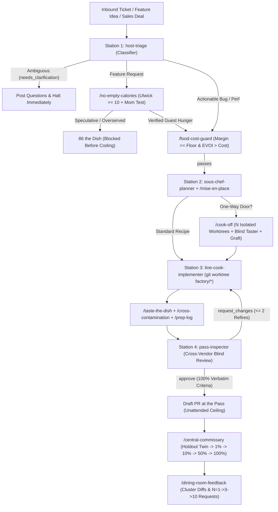

# `principled-product-factory` — The Kitchen Brigade Skill Stack for Claude Code & Cursor

A **33-skill modular cookbook** and **5-station subagent brigade** (`Brigade de Cuisine`) for **Claude Code**, **Cursor**, and **Antigravity**.

Instead of a single bloated prompt that fades after three turns, `principled-product-factory` gives your coding agent a complete, self-correcting product and engineering operating system:
1. **Menu Triage & Food-Cost Guards (`/no-empty-calories`, `/food-cost-guard`)**: Refuses to build speculative features (*"diners at some point might order it"*) or negative-margin AI wrappers before a single burner is lit.
2. **4-Station Kitchen Brigade (`/kitchen-brigade` + `agents/*.md`)**: Routes every ticket through stateless task-mode subagents—**`host-triage` $\to$ (`forager-researcher`) $\to$ `sous-chef-planner` $\to$ `line-cook-implementer` $\to$ `pass-inspector`**—ending in a blind-inspected Draft Pull Request on an isolated `factory/*` branch.
3. **Scientific Reduction Loops & Cook-Offs (`/cook-off`, `/health-inspector`, `/taste-the-dish`, `/prep-log`)**: Runs parallel multi-cook bakeoffs on isolated `git worktree` cutting boards, grafts the best ideas, proves findings with real command execution, and logs every bracket to `decisions.tsv`.
4. **Sommelier Enterprise Deal Desk & Continuous Flywheel (`/sommelier-table-pitch`, `/dining-room-feedback`)**: Structures 6-step Challenger Sale pitches ($\text{COI} \ge 3\times \text{ACV}$), holds Constructive Tension on off-menu demands and discounts, cures buyer FOMU with JOLT, and clusters plates sent back (`user_correction_diff`) into new recipes.

---

## 1. Install in 30 Seconds (Claude Code & Cursor)

### Option A: Claude Code Plugin Marketplace (Recommended)
Run these two commands inside Claude Code:
```text
/plugin marketplace add agronomist/principled-product-factory
/plugin install kitchen-brigade@principled-product-factory
```

### Option B: Global or Project-Local Script Install (`install.sh`)
Clone the repository and run `./install.sh` to symlink all 33 skills and 5 Claude Code station subagents into `~/.claude/skills`, `~/.claude/agents`, and `~/.cursor/skills`:
```bash
git clone https://github.com/agronomist/principled-product-factory.git
cd principled-product-factory

# Install globally for all your repositories (~/.claude & ~/.cursor)
./install.sh

# Or install into one specific project directory
./install.sh /path/to/your/project
```

### Option C: First-Time Kitchen Setup inside Claude Code
Once installed, open Claude Code in any repository and type:
```text
/setup-kitchen
```
It will let you pick a token budget (**Bistro Fast**, **Michelin Standard**, or **Tasting Menu Maximum**), map models to your stations, and offer to generate a live tasting harness (`/taste-the-dish`) for your app. Need a quick tour at any time? Type **`/kitchen-help`**.

---

## 2. How an Order Moves Through the Kitchen



---

## 3. Copy-Paste Prompts for Common Orders in Claude Code

### Turn a GitHub Issue or Bug into a Blind-Inspected Draft PR
```text
/head-chef-mode Run the ticket-to-pass playbook on issue #202 ("Duplicate webhook notifications on retry"). Route through host-triage, sous-chef-planner, line-cook-implementer (on an isolated git worktree branch factory/issue-202), and pass-inspector. Stop at a Draft PR and log every station to decisions.tsv.
```

### Test if a Feature Idea Is Real Customer Value or the "Build Trap"
```text
/head-chef-mode Run the test-kitchen-tasting playbook on this proposal: "<describe feature>". Score it with /no-empty-calories (Ulwick JTBD Opportunity Score + Mom Test commitment tier) and /food-cost-guard (4-axis AI filter + unit contribution margin). Tell me plainly if we should cook it, run a Stage A pop-up, or 86 it.
```

### Run a 3-Cook Bakeoff (`/cook-off`) on a Tough Architecture Decision
```text
/cook-off We need to design the state persistence and retry boundary for <module>. Spawn 3 contenders on isolated git worktrees, judge them blind against a 4-criterion rubric (Liskov contracts, food-cost efficiency, failure recovery, smallest API surface), pick the cleanest base, and graft the best edge-case guards from the runners-up.
```

### Hillclimb a Metric or Slow Endpoint (`/recipe-reduction-loop`)
```text
/head-chef-mode Run the recipe-reduction-loop playbook to improve <metric> from <baseline> to <target>. Capture the baseline with /taste-the-dish and /thermometer-check first, run one atomic hypothesis bracket at a time (commit if VERIFIED, hard-revert if regressed or INCONCLUSIVE), enforce /principle-check-the-oven after 2 failed tweaks, and log every bracket to decisions.tsv.
```

### Prepare an Enterprise Challenger Sales Pitch & Push Back on a Discount
```text
/sommelier-table-pitch Prepare an enterprise deal desk playbook for <Prospect Name> ($60k ACV). Write the 6-step Commercial Teaching choreography quantifying their annual Cost of Inaction (>= 3x ACV), tailor briefs for the CFO, VP Eng, Champion, and Operator, write a Constructive Tension pushback script for their custom feature/discount request, and include a JOLT playbook to close within 14 days.
```

### Adversarial Pre-Merge Health Inspection (`/health-inspector` + `/cross-contamination`)
```text
/health-inspector Stress-test the current branch diff against main. Only report violations you prove with a real failing command or repro script. Then run /cross-contamination to identify the single safety fact downstream callers depend on and prove it by running real code.
```

### Morning Catch-Up After an Overnight Run (`/shift-handoff`)
```text
/shift-handoff Catch me up on everything that changed in the kitchen since my last message. Read decisions.tsv and active factory/* branches, summarize what passed tasting and what was dumped, and list every Draft PR waiting at the pass with everything I need to decide right here.
```

---

## 4. Complete Directory of All 33 Skills & 5 Station Subagents

### Native Claude Code Station Subagents (`agents/` $\to$ `.claude/agents/`)
| Subagent | Station Role & Tool Surface |
| :--- | :--- |
| **[`host-triage`](agents/host-triage.md)** | **Station 1 (Classifier)**: Read-only (`Read, Grep, Glob`). Classifies ticket type, priority, complexity, labels, or halts with `needs_clarification`. |
| **[`forager-researcher`](agents/forager-researcher.md)** | **Optional Forager (Researcher)**: Read + Web (`Read, Grep, Glob, WebSearch, WebFetch`). Sources upstream facts and saves a pass-by-ID prep note. |
| **[`sous-chef-planner`](agents/sous-chef-planner.md)** | **Station 2 (Analyst)**: Read-only (`Read, Grep, Glob`). Plans against a live checkout, defines `/mise-en-place` types, and writes **verbatim plating criteria**. |
| **[`line-cook-implementer`](agents/line-cook-implementer.md)** | **Station 3 (Implementer)**: Full worktree tools (`Read, Edit, Write, Grep, Glob, Bash`). Cooks on `factory/<ticket-id>`, runs `/taste-the-dish`, and commits. |
| **[`pass-inspector`](agents/pass-inspector.md)** | **Station 4 (Blind Reviewer)**: Read + test runner (`Read, Grep, Glob, Bash` — **`Edit` and `Write` structurally removed**). Grades verbatim criteria on a cross-vendor model. |

### Master Mode & Onboarding Skills
| Skill | Purpose |
| :--- | :--- |
| **[`/head-chef-mode`](skills/head-chef-mode/SKILL.md)** | Master router, [`station-brief.md`](skills/head-chef-mode/station-brief.md), and 7 service playbooks ([`ticket-to-pass`](skills/head-chef-mode/playbooks/ticket-to-pass.md), [`test-kitchen-tasting`](skills/head-chef-mode/playbooks/test-kitchen-tasting.md), [`recipe-reduction-loop`](skills/head-chef-mode/playbooks/recipe-reduction-loop.md), [`sommelier-table-pitch`](skills/head-chef-mode/playbooks/sommelier-table-pitch.md), [`first-tables-and-service-speed`](skills/head-chef-mode/playbooks/first-tables-and-service-speed.md), [`dining-room-harvest`](skills/head-chef-mode/playbooks/dining-room-harvest.md), [`off-menu-special`](skills/head-chef-mode/playbooks/off-menu-special.md)). |
| **[`/setup-kitchen`](skills/setup-kitchen/SKILL.md)** | Interactive setup for station model assignments, reasoning budgets, and live tasting harnesses. |
| **[`/kitchen-help`](skills/kitchen-help/SKILL.md)** | Interactive skill router, troubleshooting table, and [`references/recipe-prompts.md`](skills/kitchen-help/references/recipe-prompts.md). |

### Menu Triage, Food Cost, Brigade Line & Sommelier Skills
| Skill | Purpose |
| :--- | :--- |
| **[`/no-empty-calories`](skills/no-empty-calories/SKILL.md)** | Blocks speculative dishes; enforces Ulwick JTBD Opportunity Score $\ge 10.0$, *The Mom Test* commitment ladder, and 30-day "86-the-dish" zombie code deletion. |
| **[`/food-cost-guard`](skills/food-cost-guard/SKILL.md)** | Enforces `unit_revenue - (inference_cost + data_api_cost + hitl_prob * human_review_cost + infra_cost) >= min_margin`, 4-axis AI recipe filter, Cohort P&L, and 6-month re-pricing retro-audits. |
| **[`/kitchen-brigade`](skills/kitchen-brigade/SKILL.md)** | 4-station routing, pass-by-ID prep notes (`^[a-z0-9]+(?:-[a-z0-9]+)*$`), anti-poisoning Master Recipe Book, and Draft-PR heat-lamp ceiling on `factory/*`. |
| **[`/sommelier-table-pitch`](skills/sommelier-table-pitch/SKILL.md)** | Challenger Sale 6-step commercial teaching choreography ($\text{COI} \ge 3\times \text{ACV}$), buying-table pairing, Constructive Tension, and JOLT FOMU de-risking. |
| **[`/signature-dish-moat`](skills/signature-dish-moat/SKILL.md)** | April Dunford's 5-step menu positioning canvas, Hamilton Helmer's 7 Powers moat verification, and Porter purveyor-power defense. |
| **[`/dining-room-feedback`](skills/dining-room-feedback/SKILL.md)** | Clusters plates sent back (`user_correction_diff`) into Brigade tickets, graduates $N=1 \to 3 \to 10$ table requests, and updates Bayesian hunger beliefs from diner workarounds. |
| **[`/central-commissary`](skills/central-commissary/SKILL.md)** | Kitchen-line stamping press, Rule-of-Two mother-sauce harvester, $3\times$ purveyor price-shock simulator, mystery-diner holdout twin, `1%->100%` first-tables rollout, and Goldratt OEE. |
| **[`/pantry-backup-and-incident-card`](skills/pantry-backup-and-incident-card/SKILL.md)** | 3-tier pantry fallback chain (`primary -> secondary -> tertiary`), SHA-256 duplicate burn-signature Saga cleanup, and minimized JSON incident cards. |

### Mise en Place, Cook-Off, Tasting, Inspection & Shift Handoff Skills
| Skill | Purpose |
| :--- | :--- |
| **[`/mise-en-place`](skills/mise-en-place/SKILL.md)** | Sketches immutable container types, function signatures, and Liskov pre/postconditions before cooking starts. |
| **[`/cook-off`](skills/cook-off/SKILL.md)** | Spawns $N$ line cooks on isolated `git worktree` cutting boards, scores with a cross-vendor blind taster, picks the simplest base dish, and grafts winning garnishes. |
| **[`/health-inspector`](skills/health-inspector/SKILL.md)** | Multi-model adversarial inspection where violations survive **only** if proven by a real failing command. |
| **[`/cross-contamination`](skills/cross-contamination/SKILL.md)** | Finds what a change could spoil three stations downstream beyond `grep`, and proves the one safety fact by running real code. |
| **[`/taste-the-dish`](skills/taste-the-dish/SKILL.md)** | Generates and maintains a project-local live tasting harness (`Fire Up -> Station Check -> Plate -> Proof -> Dishpit`) and living diner-POV menu map (`features/`). |
| **[`/thermometer-check`](skills/thermometer-check/SKILL.md)** | Vets any performance, latency, cost, or eval number across 7 physical and statistical checks (including CUPED & SRM). |
| **[`/haccp-statechart`](skills/haccp-statechart/SKILL.md)** | Formally verifies concurrency (`WIP_LIMIT = 5`), retry, Saga, and circuit-breaker state machines, proves mutation sensitivity, and draws Mermaid statecharts. |
| **[`/prep-log`](skills/prep-log/SKILL.md)** | Appends sanitized single-line TSV rows to `decisions.tsv` ([`scripts/log-decision.sh`](skills/head-chef-mode/scripts/log-decision.sh)) and audits evidence pointers with a cross-vendor taster. |
| **[`/sharpen-the-knives`](skills/sharpen-the-knives/SKILL.md)** | Eliminates recurring line-cook accidents up the 5-level hierarchy: **1. Kitchen Layout $\to$ 2. Labeled Containers $\to$ 3. Fix-Naming Alarm $\to$ 4. Taste Test $\to$ 5. Wall Sign last**. |
| **[`/shift-handoff`](skills/shift-handoff/SKILL.md)** | Catches the Head Chef up after an overnight shift in plain words and small visuals, listing every Draft PR waiting at the pass. |
| **[`/update-the-cookbook`](skills/update-the-cookbook/SKILL.md)** | Mines the shift transcript for durable 6-month lessons and proposes surgical updates to `skills/*/SKILL.md`. |
| **[`/plain-english-menu`](skills/plain-english-menu/SKILL.md)** | Strips corporate foam and AI tells out of prose, labels evidence (`measured`, `inferred`, `guess`), and supplies the **Soccer & Seinfeld Metaphor Bank**. |

### Ten One-Rule Kitchen Principles (`principle-*`)
- [`principle-no-empty-calories`](skills/principle-no-empty-calories/SKILL.md) · [`principle-food-cost-floor`](skills/principle-food-cost-floor/SKILL.md) · [`principle-expediter-calls-not-cooks`](skills/principle-expediter-calls-not-cooks/SKILL.md) · [`principle-blind-taste-test`](skills/principle-blind-taste-test/SKILL.md) · [`principle-plate-at-the-pass`](skills/principle-plate-at-the-pass/SKILL.md) · [`principle-clean-cutting-boards`](skills/principle-clean-cutting-boards/SKILL.md) · [`principle-check-the-oven`](skills/principle-check-the-oven/SKILL.md) · [`principle-taste-before-serving`](skills/principle-taste-before-serving/SKILL.md) · [`principle-one-course-at-a-time`](skills/principle-one-course-at-a-time/SKILL.md) · [`principle-kitchen-muscle-memory`](skills/principle-kitchen-muscle-memory/SKILL.md)

---

## 5. Claude Code PreToolUse Safety Hook (`hooks/pre-tool-guard.sh`)

This repository includes an automatic Claude Code `PreToolUse` hook in [`.claude/settings.json`](.claude/settings.json) backed by [`hooks/pre-tool-guard.sh`](hooks/pre-tool-guard.sh):
- **Blocks direct `git push` to `main`, `master`, `production`, or `release`** at the shell boundary with an error naming the exact fix (`factory/<ticket-slug>`).
- **Blocks `gh pr merge`** from agent tool invocations so merging always remains a human Head Chef decision.

```bash
# Validate all 33 skills and 5 Claude Code station subagents
bash skills/head-chef-mode/scripts/validate-skills.sh
```
