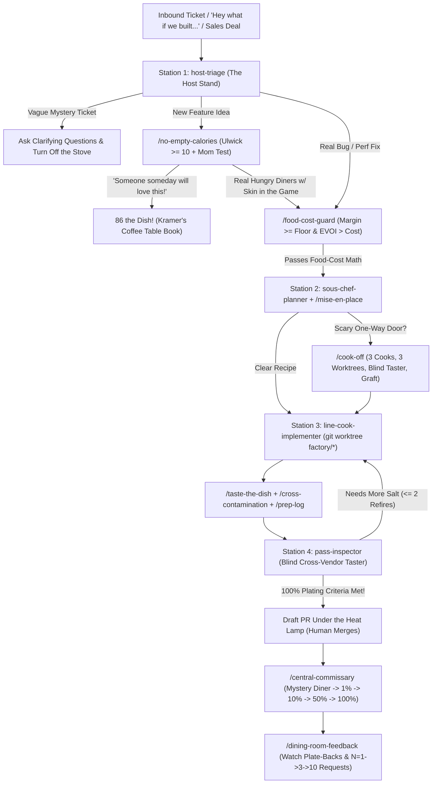

# Welcome to the Kitchen (`principled-product-factory`)

Grab an apron. Wash your hands. Leave your "let's slap an AI chatbot on the sidebar and see what happens" ideas by the dumpster out back.

**`principled-product-factory`** is a **34-skill modular cookbook** and **5-station subagent brigade** (`Brigade de Cuisine`) for **Claude Code**, **Cursor**, and **Antigravity**.

We built this because AI coding agents have made writing code 10x faster—which mostly means teams can now cook **inedible dishes nobody ordered at 10x the speed**, burn through GPU token budgets like Kramer and Newman driving a mail truck full of 10-cent soda cans to Michigan, and call it "velocity."

Instead of one giant 3,000-line prompt that your agent forgets by turn four, this repo organizes your workflow like a real, slightly obsessive, Michelin-starred kitchen:

1. **No Empty Calories (`/no-empty-calories`)**: If a feature request is backed only by *"I think users at some point will really like it!"*, we **86 it at the door** before a single burner is lit.
2. **Food-Cost Math Before Firing (`/food-cost-guard`)**: Every dish has to pay for its own ingredients (tokens, third-party APIs, infrastructure, and human review time). If a dish loses money on every plate served, it doesn't go on the menu.
3. **A Four-Station Kitchen Brigade (`/kitchen-brigade` + `agents/*.md`)**: The Expediter calls the tickets at the pass and never touches a frying pan. Every ticket moves through four isolated stations—**`host-triage` $\to$ (`forager-researcher`) $\to$ `sous-chef-planner` $\to$ `line-cook-implementer` $\to$ `pass-inspector`**—ending in a plated **Draft Pull Request** sitting under the heat lamp for you (the Head Chef) to ring the bell and merge.
4. **Blind Taste Tests & Clean Cutting Boards (`/cook-off`, `/health-inspector`, `/taste-the-dish`)**: Line cooks don't grade their own sauces. Our Pass Inspector runs on a different model vendor, never hears the Line Cook's excuses, and literally has its `Edit` and `Write` tools taken away so it can't secretly re-salt the soup.
5. **A Master Sommelier at the Deal Desk (`/sommelier-table-pitch`, `/dining-room-feedback`)**: When an enterprise prospect demands a bizarre off-menu custom feature or a 40% discount just to sign, our Challenger Sale Sommelier holds polite Constructive Tension instead of caving like a nervous waiter—while quietly logging what diners *actually* send back to the pass so the menu gets smarter every week.

---

## 1. Set Up Your Station in 30 Seconds

### Option A: Inside Claude Code (Two Commands, Zero Chopping)
Open Claude Code and drop these two lines in the chat:
```text
/plugin marketplace add agronomist/principled-product-factory
/plugin install kitchen-brigade@principled-product-factory
```

### Option B: The One-Line Shell Installer (`install.sh`)
Prefer symlinks you can see with your own eyes? Clone the repo and run `./install.sh`:
```bash
git clone https://github.com/agronomist/principled-product-factory.git
cd principled-product-factory

# Install globally for every repo on your machine (~/.claude & ~/.cursor)
./install.sh

# Or install into one specific project
./install.sh /path/to/your/project
```

### Option C: First Time in the Kitchen?
Once installed, type this in Claude Code:
```text
/setup-kitchen
```
It will ask what kind of shift you're running (**Bistro Fast** to save tokens, **Michelin Standard** for daily service, or **Tasting Menu Maximum** when you need three models dueling on isolated cutting boards), wire up your station models, and offer to build a live tasting harness (`/taste-the-dish`) for your app.

Lost in the walk-in freezer? Type **`/kitchen-help`** anytime and we'll hand you the exact prompt you need.

---

## 2. How an Order Moves From the Door to the Pass

Here is what happens when a ticket walks into our kitchen (spoiler: most bad ideas don't survive past the Host stand):



---

## 3. Copy-Paste Orders for Your Next Shift

Don't memorize 33 skill names. Just type **`/head-chef-mode`** and tell the kitchen what you want cooked. Here are seven fan favorites you can paste right into Claude Code:

### 1. Turn an Issue into a Blind-Inspected Draft PR
> *"Look, a bug walked in. Run it through the 4 stations on a clean cutting board, taste it, and leave a Draft PR under the heat lamp."*
```text
/head-chef-mode Run the ticket-to-pass playbook on issue #202 ("Duplicate webhook notifications on retry"). Route through host-triage, sous-chef-planner, line-cook-implementer (on an isolated git worktree branch factory/issue-202), and pass-inspector. Stop at a Draft PR and log every station to decisions.tsv.
```

### 2. The "Is This an Urban Sombrero?" Feature Triage
> *"Someone wants to spend 3 weeks building a 3D animated dashboard. Let's check if customers actually care or if we're falling into the Build Trap."*
```text
/head-chef-mode Run the test-kitchen-tasting playbook on this proposal: "<describe feature>". Score it with /no-empty-calories (Ulwick JTBD Opportunity Score + Mom Test commitment tier) and /food-cost-guard (4-axis AI filter + unit contribution margin). Tell me plainly if we should cook it, run a Stage A pop-up, or 86 it.
```

### 3. The 3-Chef Cook-Off (`/cook-off`)
> *"We only get one shot at this architecture decision. Put three cooks on three separate cutting boards, blind-taste all three, and combine the best parts."*
```text
/cook-off We need to design the state persistence and retry boundary for <module>. Spawn 3 contenders on isolated git worktrees, judge them blind against a 4-criterion rubric (Liskov contracts, food-cost efficiency, failure recovery, smallest API surface), pick the cleanest base, and graft the best edge-case guards from the runners-up.
```

### 4. Reduce the Sauce Until It Shines (`/recipe-reduction-loop`)
> *"This endpoint is slow. Try one small tweak at a time, check the meat thermometer, keep what works, and dump the pan immediately if it regresses."*
```text
/head-chef-mode Run the recipe-reduction-loop playbook to improve <metric> from <baseline> to <target>. Capture the baseline with /taste-the-dish and /thermometer-check first, run one atomic hypothesis bracket at a time (commit if VERIFIED, hard-revert if regressed or INCONCLUSIVE), enforce /principle-check-the-oven after 2 failed tweaks, and log every bracket to decisions.tsv.
```

### 5. Call the Sommelier to the VIP Table (`/sommelier-table-pitch`)
> *"A big enterprise prospect wants a 25% discount AND a weird custom XML button. Help me push back with class and close the deal."*
```text
/sommelier-table-pitch Prepare an enterprise deal desk playbook for <Prospect Name> ($60k ACV). Write the 6-step Commercial Teaching choreography quantifying their annual Cost of Inaction (>= 3x ACV), tailor briefs for the CFO, VP Eng, Champion, and Operator, write a Constructive Tension pushback script for their custom feature/discount request, and include a JOLT playbook to close within 14 days.
```

### 6. Surprise Health Inspection (`/health-inspector` + `/cross-contamination`)
> *"Tear this branch apart. No opinions about variable names—only complaints you can prove by breaking the code with a real command."*
```text
/health-inspector Stress-test the current branch diff against main. Only report violations you prove with a real failing command or repro script. Then run /cross-contamination to identify the single safety fact downstream callers depend on and prove it by running real code.
```

### 7. Morning Coffee Shift Handoff (`/shift-handoff`)
> *"I went to sleep while the kitchen ran overnight. What happened, what got dumped in the sink, and what's waiting at the pass for my signature?"*
```text
/shift-handoff Catch me up on everything that changed in the kitchen since my last message. Read decisions.tsv and active factory/* branches, summarize what passed tasting and what was dumped, and list every Draft PR waiting at the pass with everything I need to decide right here.
```

---

## 4. Meet the Brigade (All 5 Subagents & 34 Skills)

### The 5 Native Claude Code Station Subagents (`agents/` $\to$ `.claude/agents/`)
Each station runs in a fresh, stateless shift and only gets the exact kitchen tools it needs:

| Station Subagent | Who They Are & What Tools They Hold |
| :--- | :--- |
| **[`host-triage`](agents/host-triage.md)** | **The Host at the Door (Classifier)**: Read-only (`Read, Grep, Glob`). Checks the reservation, tags the ticket, or stops the line with `needs_clarification` before anyone wastes prep time. |
| **[`forager-researcher`](agents/forager-researcher.md)** | **The Forager (Researcher)**: Read + Web (`Read, Grep, Glob, WebSearch, WebFetch`). Heads out to the farmers' market when you need an upstream bug report or library changelog, and saves a pass-by-ID prep note. |
| **[`sous-chef-planner`](agents/sous-chef-planner.md)** | **The Sous Chef (Analyst)**: Read-only (`Read, Grep, Glob`). Plans against a live checkout, sets up `/mise-en-place` containers, and writes the **verbatim plating criteria**. |
| **[`line-cook-implementer`](agents/line-cook-implementer.md)** | **The Line Cook (Implementer)**: Full station tools (`Read, Edit, Write, Grep, Glob, Bash`). Cooks on an isolated `factory/<ticket-id>` branch, tastes the dish, and plates the commit. |
| **[`pass-inspector`](agents/pass-inspector.md)** | **The Blind Pass Inspector (Reviewer)**: Read + test runner (`Read, Grep, Glob, Bash` — **`Edit` and `Write` are confiscated at the door**). Grades verbatim criteria on a different model vendor without hearing the Line Cook's excuses. |

---

### Master Mode & Onboarding (3 Skills)
| Skill | What It Does on the Line |
| :--- | :--- |
| **[`/head-chef-mode`](skills/head-chef-mode/SKILL.md)** | The Expediter at the pass. Matches your request to one of 7 service playbooks ([`ticket-to-pass`](skills/head-chef-mode/playbooks/ticket-to-pass.md), [`test-kitchen-tasting`](skills/head-chef-mode/playbooks/test-kitchen-tasting.md), [`recipe-reduction-loop`](skills/head-chef-mode/playbooks/recipe-reduction-loop.md), [`sommelier-table-pitch`](skills/head-chef-mode/playbooks/sommelier-table-pitch.md), [`first-tables-and-service-speed`](skills/head-chef-mode/playbooks/first-tables-and-service-speed.md), [`dining-room-harvest`](skills/head-chef-mode/playbooks/dining-room-harvest.md), [`off-menu-special`](skills/head-chef-mode/playbooks/off-menu-special.md)) and hands [`station-brief.md`](skills/head-chef-mode/station-brief.md) to every cook. |
| **[`/setup-kitchen`](skills/setup-kitchen/SKILL.md)** | Interactive 1-minute setup for station models, token budgets, and live tasting harnesses. |
| **[`/kitchen-help`](skills/kitchen-help/SKILL.md)** | Friendly maitre d' that routes you to the right skill, troubleshoots weird shifts, and hands you [`references/recipe-prompts.md`](skills/kitchen-help/references/recipe-prompts.md). |

### Menu Value, Food Cost, Brigade Line & Sommelier (8 Skills)
| Skill | What It Does on the Line |
| :--- | :--- |
| **[`/no-empty-calories`](skills/no-empty-calories/SKILL.md)** | Our Anti-Build-Trap bouncer. Requires Ulwick JTBD Opportunity Score $\ge 10.0$, *The Mom Test* skin-in-the-game, and 86's untouched zombie features after 30 days. |
| **[`/food-cost-guard`](skills/food-cost-guard/SKILL.md)** | Enforces `unit_revenue - (inference_cost + data_api_cost + hitl_prob * human_review_cost + infra_cost) >= min_margin`, blocks molecular-gastronomy AI foam where SQL suffices, and runs 6-month menu re-pricing audits. |
| **[`/kitchen-brigade`](skills/kitchen-brigade/SKILL.md)** | Runs the 4 stations in order, passes long memos by validated ticket ID (`^[a-z0-9]+(?:-[a-z0-9]+)*$`), guards the Master Recipe Book against prompt poisoning, and stops at a Draft PR. |
| **[`/sommelier-table-pitch`](skills/sommelier-table-pitch/SKILL.md)** | Challenger Sale 6-step commercial teaching choreography ($\text{COI} \ge 3\times \text{ACV}$), pairing value to every seat at the table, Give-Get check control, and JOLT menu-paralysis de-risking. |
| **[`/signature-dish-moat`](skills/signature-dish-moat/SKILL.md)** | April Dunford's 5-step menu positioning canvas, Hamilton Helmer's 7 Powers moat check, and Porter defense against greedy truffle purveyors. |
| **[`/dining-room-feedback`](skills/dining-room-feedback/SKILL.md)** | Watches plates sent back to the pass (`user_correction_diff`), graduates $N=1 \to 3 \to 10$ off-menu requests, and updates Bayesian hunger beliefs from diner workarounds. |
| **[`/central-commissary`](skills/central-commissary/SKILL.md)** | Stamps out new `products/<slug>/` kitchen lines, harvests Rule-of-Two mother sauces into `platform/`, simulates $3\times$ supplier price shocks, runs mystery-diner holdouts, serves `1%->100%` first tables, and finds Goldratt OEE bottlenecks. |
| **[`/pantry-backup-and-incident-card`](skills/pantry-backup-and-incident-card/SKILL.md)** | 3-tier pantry fallback chain (`primary -> secondary -> tertiary`), SHA-256 duplicate burn-signature Saga pan-dumping, and laminated JSON incident cards for $\pm 3\sigma$ excursions. |

### Mise en Place, Cook-Off, Tasting, Inspection & Shift Handoff (13 Skills)
| Skill | What It Does on the Line |
| :--- | :--- |
| **[`/mise-en-place`](skills/mise-en-place/SKILL.md)** | Measures and labels every container (types, function signatures, Liskov pre/postconditions) before anyone lights a stove. |
| **[`/cook-off`](skills/cook-off/SKILL.md)** | Puts $N$ line cooks on isolated `git worktree` cutting boards with the same brief, blind-tastes them with a cross-vendor judge, picks the simplest base, and grafts the winning garnishes. |
| **[`/health-inspector`](skills/health-inspector/SKILL.md)** | Adversarial inspection where complaints only survive if the inspector proves them with a real failing command. |
| **[`/cross-contamination`](skills/cross-contamination/SKILL.md)** | Checks if your garlic prep just ruined the pastry station three hops downstream, and proves the one safety fact by running real code. |
| **[`/taste-the-dish`](skills/taste-the-dish/SKILL.md)** | Builds and maintains a live app tasting harness (`Fire Up -> Station Check -> Plate -> Proof -> Dishpit`) and living diner-POV menu map ([`features/`](features/README.md)). |
| **[`/verify-kitchen-cookbook`](skills/verify-kitchen-cookbook/SKILL.md)** | This repository's own live tasting harness! Drives every feature in [`features/README.md`](features/README.md), tests negative mutations, and writes `.audit/evidence/proof-kitchen-cookbook.json`. |
| **[`/thermometer-check`](skills/thermometer-check/SKILL.md)** | Sticks a meat thermometer into any benchmark or eval number across 7 checks (did cooking happen, physical limiter, zero spoilage, repeatability, parity, CUPED/SRM, relevance). |
| **[`/haccp-statechart`](skills/haccp-statechart/SKILL.md)** | Formally verifies critical concurrency (`WIP_LIMIT = 5`), retry, Saga, and circuit-breaker state machines, proves checks fail on spoiled mutations, and draws Mermaid statecharts. |
| **[`/prep-log`](skills/prep-log/SKILL.md)** | Appends sanitized single-line TSV rows to `decisions.tsv` ([`scripts/log-decision.sh`](skills/head-chef-mode/scripts/log-decision.sh)) and audits evidence pointers with a cross-vendor taster. |
| **[`/sharpen-the-knives`](skills/sharpen-the-knives/SKILL.md)** | Fixes recurring kitchen accidents up the 5-level hierarchy: **1. Kitchen Layout $\to$ 2. Labeled Containers $\to$ 3. Fix-Naming Alarm $\to$ 4. Taste Test $\to$ 5. Wall Sign last**. |
| **[`/shift-handoff`](skills/shift-handoff/SKILL.md)** | Morning catch-up over espresso: what shipped, what got dumped, and every Draft PR waiting under the heat lamp with everything you need to decide right now. |
| **[`/update-the-cookbook`](skills/update-the-cookbook/SKILL.md)** | Mines the shift transcript for durable 6-month lessons and proposes surgical upgrades to `skills/*/SKILL.md`. |
| **[`/plain-english-menu`](skills/plain-english-menu/SKILL.md)** | Scrapes off AI buzzword foam, labels evidence (`measured`, `inferred`, `guess`), and supplies our **Soccer & Seinfeld Metaphor Bank**. |

### The 10 Non-Negotiable Kitchen Principles (`principle-*`)
- [`principle-no-empty-calories`](skills/principle-no-empty-calories/SKILL.md) — *Don't cook Kramer's Coffee Table Book.*
- [`principle-food-cost-floor`](skills/principle-food-cost-floor/SKILL.md) — *Don't run the Michigan bottle-deposit mail truck.*
- [`principle-expediter-calls-not-cooks`](skills/principle-expediter-calls-not-cooks/SKILL.md) — *The Expediter calls the tickets, never works the fryer.*
- [`principle-blind-taste-test`](skills/principle-blind-taste-test/SKILL.md) — *Cooks never grade their own sauce.*
- [`principle-plate-at-the-pass`](skills/principle-plate-at-the-pass/SKILL.md) — *Unattended shifts stop at a Draft PR under the heat lamp.*
- [`principle-clean-cutting-boards`](skills/principle-clean-cutting-boards/SKILL.md) — *Separate worktrees + The Soup Nazi's 5-ticket limit (`WIP_LIMIT = 5`).*
- [`principle-check-the-oven`](skills/principle-check-the-oven/SKILL.md) — *If two tweaks fail the same check, check if the oven is lit; if George hits the hydrant twice, stop parallel parking.*
- [`principle-taste-before-serving`](skills/principle-taste-before-serving/SKILL.md) — *"The recipe compiled" is not a taste test.*
- [`principle-one-course-at-a-time`](skills/principle-one-course-at-a-time/SKILL.md) — *Cook riskiest-ingredient-first; keep or dump one pan at a time.*
- [`principle-kitchen-muscle-memory`](skills/principle-kitchen-muscle-memory/SKILL.md) — *Nobody reads laminated wall signs during a Saturday-night rush—encode lessons in layout, containers, and alarms.*

---

## 5. Built-In Bouncer & Executable Kitchen Levers

Instead of trusting an LLM to pinky-promise it read the rules, we ship executable shell levers in [`skills/head-chef-mode/scripts/`](skills/head-chef-mode/scripts/) and a Claude Code `PreToolUse` hook in [`.claude/settings.json`](.claude/settings.json) backed by [`hooks/pre-tool-guard.sh`](hooks/pre-tool-guard.sh):

```bash
# 1. Run the 5-step Live Tasting Harness (Fire Up -> Station Check -> Plate -> Proof -> Dishpit)
#    Drives every feature in features/README.md and writes .audit/evidence/proof-kitchen-cookbook.json
bash skills/head-chef-mode/scripts/run-live-tasting.sh

# 2. Spawn an isolated git worktree cutting board (enforces Little's Law WIP <= 5)
bash skills/head-chef-mode/scripts/spawn-worktree.sh TKT-104-auth-boundary

# 3. Strip the Line Cook's excuses & package a blind tasting bundle for pass-inspector
bash skills/head-chef-mode/scripts/cross-vendor-taste.sh HEAD~1 "All tests pass; zero regressions"

# 4. Log an atomic decision row to decisions.tsv (escapes spreadsheet formula injection)
bash skills/head-chef-mode/scripts/log-decision.sh "line-cook" "added retry jitter" "prevent thundering herd" "tests/retry.sh:PASS" "kept commit"

# 5. End-of-Shift Closing Duty (validates all 34 skills, 5 agents, feature map, and tasting proof)
bash skills/head-chef-mode/scripts/closing-duty.sh
```

Now fire up `/head-chef-mode` and let's cook something people actually want to eat.
